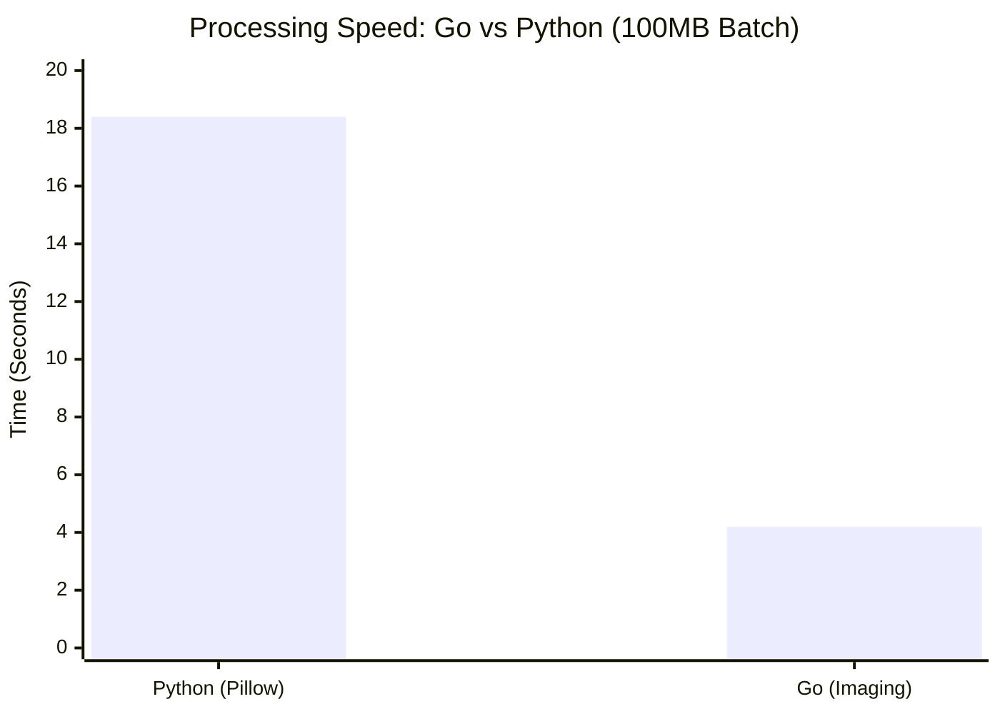
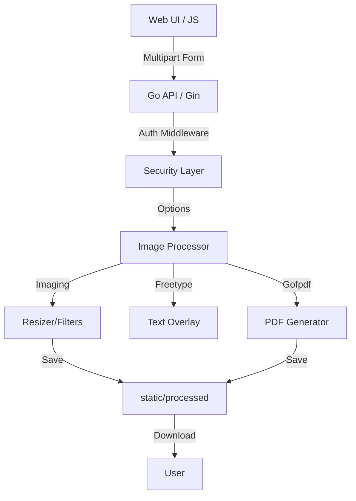

#  Image Resizer


**High-performance, secure, and modern image processing suite built with Go and Gin-Gonic.**

---

## 🚀 Key Features

| 🎭 **Artistic** | 📐 **Transform** | 🛠️ **Utility** |
| :--- | :--- | :--- |
| **Filters:** Noir, Vivid, Sepia, Invert, Grayscale | **Smart Crop:** 1:1, 16:9, 4:3 | **Batch Rename:** Custom templates |
| **Adjustments:** Brightness, Contrast, Saturation | **Resize:** % or Pixel accurate | **Zip Bundling:** Batch downloads |
| **Effects:** Pixelate, Blur, Sharpen | **Rotate:** 90°, 180°, 270° | **PDF Export:** Images to Document |
| **Overlays:** Text (Custom Font), Image | **Flip:** Horizontal & Vertical | **EXIF Strip:** Privacy protection |

---

## 📊 Performance Benchmark


*Note: The figures shown above are illustrative/approximate.*

---

## 🏗️ Architecture



---

## 🛠️ Tech Stack

- **Backend:** [Go 1.26.4+](https://go.dev/) + [Gin-Gonic](https://gin-gonic.com/)
- **Processing:** [Imaging](https://github.com/disintegration/imaging), [Freetype](https://github.com/golang/freetype), [Gofpdf](https://github.com/jung-kurt/gofpdf)
- **Frontend:** Glassmorphism UI (Vanilla CSS + Vanilla JS)
- **DevOps:** GitHub Actions, Docker (Alpine Multi-stage), [gosec](https://github.com/securego/gosec), [govulncheck](https://pkg.go.dev/golang.org/x/vuln/cmd/govulncheck)

---

## 🚦 Quick Start

### 📦 Run with Docker
```bash
docker pull ghcr.io/arumes31/image-resizer:latest
docker run -p 127.0.0.1:5000:5000   -e UI_PASSWORD="$(openssl rand -hex 16)"   -e API_KEY="$(openssl rand -hex 32)"   ghcr.io/arumes31/image-resizer:latest
```
The container runs as an unprivileged `app` user. If you bind-mount `static/uploads` or `static/processed`, make sure they are writable by that user.

The quick start publishes the port on loopback only, because the server speaks plain HTTP and the UI password and API key would otherwise cross the network unencrypted.

### 🔒 Remote Access (HTTPS)
For access from other machines, use one of:
- **Reverse proxy (recommended):** keep the container bound to `127.0.0.1` (or an internal Docker network) and terminate HTTPS in Caddy, nginx, Traefik or similar in front of it. Set `TRUSTED_PROXIES` to the proxy address so per-client rate limiting sees real client IPs.
- **Built-in TLS:** mount a certificate and key and set `TLS_CERT_FILE` and `TLS_KEY_FILE`; the server then serves HTTPS only (TLS 1.2+) on `PORT`.
  ```bash
  docker run -p 5000:5000 -v /etc/ssl/resizer:/certs:ro     -e TLS_CERT_FILE=/certs/fullchain.pem -e TLS_KEY_FILE=/certs/privkey.pem     -e UI_PASSWORD="$(openssl rand -hex 16)" -e API_KEY="$(openssl rand -hex 32)"     ghcr.io/arumes31/image-resizer:latest
  ```

### 🔨 Development Mode
```bash
go run cmd/server/main.go
```
Open `http://localhost:5000` to access the dashboard.

### ⚙️ Configuration

| Variable | Default | Description |
| :--- | :--- | :--- |
| `API_KEY` | *(unset)* | Key for `/api/v1/*`. Must be at least 32 characters. If unset, the API rejects all requests. The old built-in default key is refused at startup. |
| `UI_PASSWORD` | *(unset)* | Enables HTTP Basic auth for the web UI and downloads. Strongly recommended for anything reachable from the internet (or put the UI behind an authenticating reverse proxy). |
| `UI_USERNAME` | `admin` | Username for `UI_PASSWORD`. |
| `MAX_UPLOAD_MB` | `32` | Maximum request body size per upload request. |
| `MAX_FILES_PER_REQUEST` | `20` | Maximum number of images per request (`0` = unlimited). |
| `RATE_LIMIT_PER_MINUTE` | `30` | Upload requests allowed per client IP per minute (`0` = disabled). |
| `MAX_CONCURRENT_JOBS` | number of CPUs | Images processed at the same time across all requests. |
| `TRUSTED_PROXIES` | *(none)* | Comma-separated proxy IPs/CIDRs whose `X-Forwarded-For` is trusted for client IP detection. |
| `UPLOAD_FOLDER` / `PROCESSED_FOLDER` | `static/uploads` / `static/processed` | Storage directories. |
| `PORT` | `5000` | Listen port. |
| `TLS_CERT_FILE` / `TLS_KEY_FILE` | *(unset)* | PEM certificate and key. When both are set the server serves HTTPS instead of HTTP. Setting only one is a startup error. |

Uploads through the web UI are CSRF-protected: browsers must send `Sec-Fetch-Site: same-origin`, and clients that do not send `Sec-Fetch-Site` must send an `X-Requested-With` header. Scripts should use the Developer API instead. `/download-all` archives are limited to 100 distinct files and 512 MB in total.

---

## 🧑‍💻 Developer API

The suite includes a secure REST API for headless automation.

**Authentication:**
All API endpoints (except `/api/v1/status`) require an API key passed via the HTTP headers.
- **Header:** `X-API-Key`
- **Value:** Your configured secure key.

### Endpoints

#### 1. System Status
- **Method:** `GET`
- **Path:** `/api/v1/status`
- **Description:** Check system health and current API version.
- **Response:**
  ```json
  {
    "status": "operational",
    "version": "v2.0.0-go"
  }
  ```

#### 2. Process Images
- **Method:** `POST`
- **Path:** `/api/v1/process`
- **Content-Type:** `multipart/form-data`
- **Description:** Upload one or more images and apply various transformations, filters, and optimizations.

**Form Parameters:**

| Parameter | Type | Default | Description |
| :--- | :--- | :--- | :--- |
| `files[]` | File | - | **(Required)** Images to process. Allowed: jpg, png, gif, bmp, tiff, webp, ico |
| `operation` | String | `percentage` | The resize operation: `percentage` or `fill` |
| `percentage` | Integer | `100` | Scale percentage (max: 500) |
| `width` | Integer | `0` | Target width in pixels (max: 10000) |
| `height` | Integer | `0` | Target height in pixels (max: 10000) |
| `quality` | Integer | `85` | Output image quality (1-100) |
| `rotation` | Integer | `0` | Degrees to rotate: `0`, `90`, `180`, `270` |
| `brightness` | Float | `0` | Adjust brightness |
| `contrast` | Float | `0` | Adjust contrast |
| `saturation` | Float | `0` | Adjust saturation |
| `pixelate` | Integer | `0` | Pixelation factor |
| `watermark` | File | - | Image file to use as a watermark overlay |
| `format` | String | `jpg` | Output format: `jpg`, `jpeg`, `png`, `gif`, `bmp`, `tiff`, `webp`, `ico`, `pdf` |
| `resize_method` | String | - | Resampling method |
| `flip` | String | - | Flip direction: `horizontal`, `vertical` |
| `filters[]` | String Array| - | Array of filters (e.g., Noir, Vivid, Sepia) |
| `text_overlay` | String | - | Text to render over the image |
| `text_color` | String | - | Hex color code for the text overlay |
| `strip_exif` | String | - | Set to `on` to remove EXIF metadata |
| `copyright` | String | - | Copyright text to embed in metadata |
| `crop` | String | - | Crop aspect ratio |
| `vignette` | String | - | Set to `on` to apply a vignette effect |
| `rename_template`| String | - | Template for renaming output files (`{name}` = original name). Must not contain `/`, `\` or `..`; other characters outside `A-Za-z0-9._-` become `_`. |

**Responses:**

*Success (200 OK):*
```json
{
  "results": [
    {
      "originalName": "photo.jpg",
      "processedName": "processed_photo_3f9c2b7e8a1d4c6f9e0b2a4d6c8e0f12.jpg",
      "originalSize": "4000x3000",
      "newSize": "2000x1500"
    }
  ]
}
```

*Partial Failure (200 OK):*
If some files fail but others succeed, the response includes both `results` and `errors` arrays.

*Unprocessable Entity (422 Unprocessable Entity):*
Returned if all uploaded files fail to process. Includes an `errors` array.

*Bad Request (400 Bad Request):*
Returned for invalid form data, unallowed file extensions or formats, invalid rename templates, or too many files.

*Payload Too Large (413) / Too Many Requests (429):*
Returned when the request body exceeds `MAX_UPLOAD_MB` or the per-IP rate limit is hit.

Processed files are named with a random 128-bit suffix and can be fetched via `/processed/<processedName>` or `/download/<processedName>`.

---

## 🔒 Security & Privacy
- **Privacy:** One-click EXIF stripping removes metadata (GPS, Timestamps).
- **Safety:** Constant-time comparison for API keys; request body cap, file count limit, per-IP rate limit and processing concurrency limit; images over 40 megapixels (input or output) are rejected before decoding to prevent decompression bombs.
- **Isolation:** Uploads and outputs use random, unguessable names; rename templates cannot introduce path components.
- **Audited:** Scanned with `gosec` and `govulncheck` on every commit.

---
*Built with ❤️ by arumes31 - 2026 Edition*
